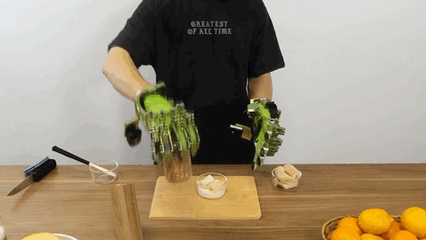
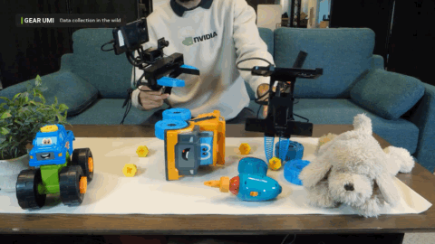
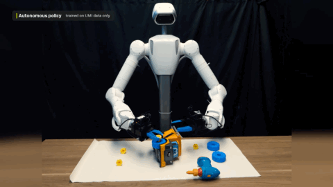
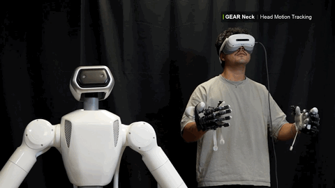
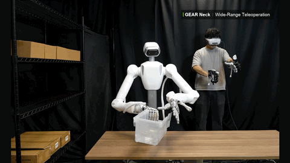

<div align="center">

  
  
  

</div>

<div align="center">

[](https://research.nvidia.com/labs/gear/hardware-prototypes/)
[](https://research.nvidia.com/labs/gear/gr00t-2)
[](LICENSE)
[](LICENSES/CC-BY-4.0.txt)

</div>

---

# GR00T Data Hardware Prototypes

This repository contains open-source hardware prototypes from the NVIDIA GEAR team for collecting high-quality training data for robot foundation models. We validated the designs by collecting data for **GR00T&nbsp;2**. Each project includes a bill of materials, mechanical and electrical design files, a step-by-step assembly guide, and a software guide. We currently release:

- **GEAR DexUMI**: a wearable hand exoskeleton for collecting dexterous post-training data;
- **GEAR UMI**: a handheld flexure gripper for collecting manipulation data in the wild, with no robot needed;
- **GEAR Neck**: a three-axis (yaw, roll, pitch) camera neck that follows a teleoperator's headset.

Each project has a documentation website at [https://research.nvidia.com/labs/gear/hardware-prototypes/](https://research.nvidia.com/labs/gear/hardware-prototypes/), with all videos and downloads. **The hardware design files (CAD, drawings, print files, electronics) are downloaded from the website; this repository holds the software.**

## News

- **[2026-11-09]** Initial public release of GEAR DexUMI, GEAR UMI, and GEAR Neck: data collection and control software here, with hardware designs, bills of materials, and assembly guides on the [project website](https://research.nvidia.com/labs/gear/hardware-prototypes/).

## Table of Contents

- [News](#news)
- [GEAR DexUMI](#gear-dexumi)
- [GEAR UMI](#gear-umi)
- [GEAR Neck](#gear-neck)
- [What's Included](#whats-included)
  - [Setup](#setup)
    - [Data Collection Software](#data-collection-software)
    - [Neck Control Software](#neck-control-software)
- [License](#license)
- [Support and Contributing](#support-and-contributing)
- [Acknowledgments](#acknowledgments)
- [Citation](#citation)

## GEAR DexUMI

<p>
  <a href="https://research.nvidia.com/labs/gear/hardware-prototypes/GEAR_DexUMI/index.html"><strong>Website</strong></a> |
  <a href="https://research.nvidia.com/labs/gear/hardware-prototypes/GEAR_DexUMI/hardware.html"><strong>Hardware Guide</strong></a> |
  <a href="https://research.nvidia.com/labs/gear/hardware-prototypes/GEAR_DexUMI/bom.html"><strong>Bill of Materials</strong></a> |
  <a href="https://research.nvidia.com/labs/gear/hardware-prototypes/GEAR_DexUMI/software.html"><strong>Software Guide</strong></a>
</p>

<div align="center">
<table>
  <tr>
    <td align="center"><br><sub>Human demonstration with GEAR DexUMI, then the robot</sub></td>
  </tr>
</table>
</div>

A hand exoskeleton with **higher DoF and better wearability** than the original DexUMI exoskeleton, for collecting dexterous post-training data: **16 DoF per hand**, with three joint encoders on every finger (thumb included), knuckle abduction sensed on all four fingers, and normal and shear force sensed on all five fingertips (5 tactile sensors per hand).

Its bill of materials, CAD and drawings, and electronics are on the [website](https://research.nvidia.com/labs/gear/hardware-prototypes/GEAR_DexUMI/index.html) (firmware coming soon); its data collection software is in [`UMIverse_software/dexumi/`](UMIverse_software/dexumi/) and its hand monitor in [`GEAR_DexUMI/files/software/`](GEAR_DexUMI/files/software/).

## GEAR UMI

<p>
  <a href="https://research.nvidia.com/labs/gear/hardware-prototypes/GEAR_UMI/index.html"><strong>Website</strong></a> |
  <a href="https://research.nvidia.com/labs/gear/hardware-prototypes/GEAR_UMI/hardware.html"><strong>Hardware Guide</strong></a> |
  <a href="https://research.nvidia.com/labs/gear/hardware-prototypes/GEAR_UMI/bom.html"><strong>Bill of Materials</strong></a> |
  <a href="https://research.nvidia.com/labs/gear/hardware-prototypes/GEAR_UMI/software.html"><strong>Software Guide</strong></a> |
  <a href="https://research.nvidia.com/labs/gear/hardware-prototypes/GEAR_UMI/dataset.html"><strong>Dataset</strong></a>
</p>

<div align="center">
<table>
  <tr>
    <td align="center"><br><sub>Data collection in the wild</sub></td>
    <td align="center"><br><sub>Autonomous policy, trained on UMI data only</sub></td>
  </tr>
</table>
</div>

A handheld gripper for recording demonstrations anywhere. **One flexure linkage**, printed on a desktop printer, replaces the original UMI trigger's pin joints, bearings, and return springs: a short, stiff load path with little lost motion, pre-strained flexures that reopen the gripper, and TPU compliance that absorbs small rail, mount, and link-length mismatches.

We collect data in the wild with GEAR UMI grippers, train a policy on that data only, and deploy it on a robot to close the loop. [Watch the full video](https://research.nvidia.com/labs/gear/hardware-prototypes/GEAR_UMI/assets/media/gear-umi-dc-to-eval.mp4) (28 s).

Its bill of materials, print files, and electronics are on the [website](https://research.nvidia.com/labs/gear/hardware-prototypes/GEAR_UMI/index.html); its data collection software is in [`UMIverse_software/umi/`](UMIverse_software/umi/) and its gripper firmware in [`GEAR_UMI/files/firmware/`](GEAR_UMI/files/firmware/).

## GEAR Neck

<p>
  <a href="https://research.nvidia.com/labs/gear/hardware-prototypes/GEAR_Neck/index.html"><strong>Website</strong></a> |
  <a href="https://research.nvidia.com/labs/gear/hardware-prototypes/GEAR_Neck/hardware.html"><strong>Hardware Guide</strong></a> |
  <a href="https://research.nvidia.com/labs/gear/hardware-prototypes/GEAR_Neck/bom.html"><strong>Bill of Materials</strong></a> |
  <a href="https://research.nvidia.com/labs/gear/hardware-prototypes/GEAR_Neck/software.html"><strong>Software Guide</strong></a>
</p>

<div align="center">
<table>
  <tr>
    <td align="center"><br><sub>Head motion tracking</sub></td>
    <td align="center"><br><sub>Wide-range teleoperation</sub></td>
  </tr>
</table>
</div>

An active head for robot teleoperation: **3-axis rotation** (yaw, roll, and pitch) synchronizes the robot's egocentric view with the teleoperator's headset, extending a typical static view. It is compact and modular, mounting to a wide range of embodiments and vision sensors.

Its bill of materials, CAD and drawings are on the [website](https://research.nvidia.com/labs/gear/hardware-prototypes/GEAR_Neck/index.html); its control software is in [`GEAR_Neck/files/software/neck_control/`](GEAR_Neck/files/software/neck_control/).

## What's Included

| Folder | What is in it |
| --- | --- |
| [`UMIverse_software/`](UMIverse_software/) | UMI and DexUMI data collection software |
| [`GEAR_UMI/files/firmware/`](GEAR_UMI/files/firmware/) | UMI gripper firmware source |
| [`GEAR_DexUMI/files/software/`](GEAR_DexUMI/files/software/) | DexUMI hand monitor |
| [`GEAR_Neck/files/software/neck_control/`](GEAR_Neck/files/software/neck_control/) | GEAR Neck control software |
| [`LICENSES/`](LICENSES/README.md) | Retained third-party license texts |
| [`tools/`](tools/) | Install, launch and license tooling |

The hardware designs, bills of materials, and assembly guides are on the [project website](https://research.nvidia.com/labs/gear/hardware-prototypes/), under CC BY 4.0.

### Setup

#### Data Collection Software

The UMI and DexUMI data-collection software install together, into one Python
environment, with one command run from this folder (the repository root). It
needs [uv](https://docs.astral.sh/uv/) and Python 3.12, which Ubuntu 24.04 ships:

```bash
uv sync               # install both pipelines into .venv; run it again after pulling updates
```

Then start a data-collection GUI. Each one opens itself in your browser:

```bash
uv run umi_dc         # UMI station console, http://127.0.0.1:8770/
uv run dexumi_dc      # DexUMI data-collection GUI, http://127.0.0.1:8791/
```

To type `umi_dc` and `dexumi_dc` in any terminal, without `uv run`, link them
into `~/.local/bin` once:

```bash
mkdir -p ~/.local/bin && ln -sf "$PWD"/.venv/bin/{umi_dc,dexumi_dc} ~/.local/bin/
```

On a UMI station, `scripts/setup_station.sh` does this for you, along with the
system checks and the gripper's serial access: see the
[UMI software guide](UMIverse_software/umi/data_collection_scripts/UMI_USAGE_GUIDE.md).
Both commands take `--no-open` to skip the browser and `--help` for the GUI's
other options.

Each pipeline keeps its dependencies in its own `pyproject.toml`. The root
`pyproject.toml` joins them in a uv workspace with one `uv.lock`, so run
`uv sync` here and not in a pipeline folder: there it removes the packages that
only the other pipeline needs.

Record3D is downloaded separately during installation and remains replaceable.
See the [Record3D guide](LICENSES/Record3D/README.md#using-a-modified-record3d-package)
for using a modified package with either pipeline.

#### Neck Control Software

The GEAR Neck control software brings up the neck's actuators, sets its home
position and drives it by yaw, roll, and pitch. It is a member of the same uv
workspace; `uv sync` installs it along with the rest. On a computer that only
drives the neck, install it alone, from this folder:

```bash
uv sync --package gear-neck
uv run --package gear-neck neck_angles   # print the neck's yaw, pitch, and roll
```

Keep `--package gear-neck` on `uv run` too: plain `uv run` first installs every
project in the workspace. The [GEAR Neck Software Guide](https://research.nvidia.com/labs/gear/hardware-prototypes/GEAR_Neck/software.html)
covers the CAN adapter, bring-up, homing, and the Python interface.

---

## License

**Software is licensed under Apache-2.0; hardware designs and documentation under CC BY 4.0.** Apache-2.0 is the default for NVIDIA-owned software, with the LGPL-2.1-only iPhone adapters and other third-party exceptions identified in [NOTICE](NOTICE). The hardware designs (CAD, drawings, print files, electronics) and the documentation (the websites, images, videos and other media) are licensed under the [Creative Commons Attribution 4.0 International license](LICENSES/CC-BY-4.0.txt) (CC BY 4.0). See [LICENSE](LICENSE), [NOTICE](NOTICE) and [LICENSES/](LICENSES/README.md), and the full details below.

<details>
<summary>Full Licensing Details</summary>

Copyright (c) 2026 NVIDIA CORPORATION & AFFILIATES. All rights reserved.

**Software** is licensed under Apache-2.0 by default, with the
LGPL-2.1-only iPhone adapters and other third-party exceptions identified
below and in [NOTICE](NOTICE).

| Software | Notes |
| --- | --- |
| [UMI data-collection software](UMIverse_software/umi/data_collection_scripts/UMI_USAGE_GUIDE.md) | Apache-2.0 by default; the complete Record3D-derived iPhone adapter, including NVIDIA adaptations, is LGPL-2.1-only. Other third-party portions (htmx, the pyopenxr example) keep their terms; see [NOTICE](NOTICE). |
| [DexUMI data-collection software](UMIverse_software/dexumi/data_collection_scripts/DEXUMI_USAGE_GUIDE.md) | Apache-2.0 by default; the complete Record3D-derived iPhone adapter, including NVIDIA adaptations, is LGPL-2.1-only. The X Hand URDFs in `umi/assets/urdf/xhand/` are the vendor's (Beijing Xingdongjiyuan Co. Ltd.), under the MIT License ([license](LICENSES/DexUMI/XHAND-URDF-MIT.txt)). Dependencies keep their terms; see [NOTICE](NOTICE) and [dependency licenses](LICENSES/python-dependencies.md). |
| [DexUMI hand monitor](GEAR_DexUMI/files/software/dexumi-hand-monitor-v2.0.zip) | Bundled pySerial 3.5 is BSD-3-Clause ([license](LICENSES/DexUMI/pyserial-3.5/LICENSE.txt)); the ZIP includes LICENSE and NOTICE. |
| [UMI gripper firmware](GEAR_UMI/files/firmware/) | Adapted CRC16, Pico SDK, TinyUSB and STMicroelectronics code keeps its original notices. The source and electronics ZIPs carry their own LICENSE and NOTICE; the KiCad files in the electronics ZIP are hardware designs, under CC BY 4.0. |
| [GEAR Neck control software](GEAR_Neck/files/software/neck_control/README.md) | Its Python dependencies (python-can and what it needs) keep their terms; see [dependency licenses](LICENSES/python-dependencies.md). |
| `tools/data_collection/`, `tools/licenses.py`, `tools/build_umi_electronics_zips.py`, `tools/github_export.py`, root `pyproject.toml` and `uv.lock` | Install, launch and license tooling for the software above. |

**Hardware designs and documentation**: the NVIDIA hardware designs (CAD,
drawings, print files, and electronics, including the KiCad files) and the
documentation (the websites, images, videos and other media) are licensed
under the Creative Commons Attribution 4.0 International license
([CC BY 4.0](LICENSES/CC-BY-4.0.txt)). When you share or adapt them, credit NVIDIA,
link to the license, and say whether you made changes.

Third-party material is not covered by CC BY 4.0. The SteadyWin GIM manual in
`GEAR_Neck/files/firmware/` is SteadyWin's document, included unchanged for
reference. Vendor product photos (such as some bill-of-materials preview
images), vendor product names, and NVIDIA trademarks and logos are not
licensed. Vendored website libraries, on the project website, retain their original MIT licenses:

- `GEAR_DexUMI/vendor/three/` — Three.js, MIT: [license](https://research.nvidia.com/labs/gear/hardware-prototypes/GEAR_DexUMI/vendor/three/LICENSE).
- `GEAR_Neck/assets/assembly/videos/animation/vendor/` — Three.js, MIT: [license](https://research.nvidia.com/labs/gear/hardware-prototypes/GEAR_Neck/assets/assembly/videos/animation/vendor/LICENSE).
- `GEAR_Neck/vendor/three/` — Three.js, MIT: [license](https://research.nvidia.com/labs/gear/hardware-prototypes/GEAR_Neck/vendor/three/LICENSE).
- `GEAR_UMI/assets/gripper_interactive_view/vendor/fflate/` — fflate, MIT: [license](https://research.nvidia.com/labs/gear/hardware-prototypes/GEAR_UMI/assets/gripper_interactive_view/vendor/fflate/LICENSE).
- `GEAR_UMI/assets/gripper_interactive_view/vendor/three/` — Three.js, MIT: [license](https://research.nvidia.com/labs/gear/hardware-prototypes/GEAR_UMI/assets/gripper_interactive_view/vendor/three/LICENSE).
- `GEAR_UMI/vendor/three/` — Three.js, MIT: [license](https://research.nvidia.com/labs/gear/hardware-prototypes/GEAR_UMI/vendor/three/LICENSE).

Licensing files at the root:

- [LICENSE](LICENSE): the complete Apache 2.0 text for the default software scope above.
- [LICENSES/CC-BY-4.0.txt](LICENSES/CC-BY-4.0.txt): the complete CC BY 4.0 text for the hardware designs and documentation.
- [NOTICE](NOTICE): the software and hardware license scopes, and the third-party components in the software with their terms.
- [Record3D attribution and LGPL terms](LICENSES/Record3D/README.md): both iPhone adapters, their adaptations, and the separately installed Record3D package.
- [LICENSES/](LICENSES/README.md): retained third-party license texts, grouped into
  [GEAR_UMI](LICENSES/GEAR_UMI/README.md) and [DexUMI](LICENSES/DexUMI/README.md),
  and the [Python dependency list](LICENSES/python-dependencies.md).

The Python packages that `uv sync` installs are not distributed here; each
keeps its own license. The earlier UMI MIT notice in
[LICENSES/GEAR_UMI/UMI-MIT.txt](LICENSES/GEAR_UMI/UMI-MIT.txt) is retained for
provenance; it is not an alternative license for the current software.

`python3 tools/licenses.py check` verifies the software license records: SPDX
headers on the software's source files, the paths named in NOTICE, the Python
dependency list against `uv.lock`, and LICENSE/NOTICE files inside download
archives that contain source code. It also checks the Record3D adapter
notices and rejects common bundled runtime artifacts in tracked files and
ZIP/TAR member names. After changing `uv.lock`, run
`python3 tools/licenses.py deps` to regenerate the dependency list.

### Distributing a Component Separately

This submission distributes software source only. Third-party wheels,
installed environments (including `.venv` and dependency caches), container
images, and frozen executables are excluded. Installation on a user's
machine may download dependencies through `uv sync`; those downloads are
separate from this source release. Run `python3 tools/licenses.py check`
before release. Any future binary or environment distribution needs its own
component inventory and fulfillment of the applicable source/relinking terms.

This repository keeps shared policies and license texts outside individual
software folders. When assembling a standalone source archive, package,
station image, or firmware release, include the applicable license text,
component notices, and required third-party license files in that artifact.
A copy of a software subdirectory alone omits the shared licensing materials.

Use [NOTICE](NOTICE) to select the required texts and keep the notice
paths consistent with the exported layout. Preserve the original notices
with any redistributed third-party components.

<details>
<summary>Third-Party License and Copyright File Index</summary>

These are the retained license texts of current and former DexUMI Python
dependencies; [python-dependencies.md](LICENSES/python-dependencies.md)
lists every pinned package. Third-party copyright holders and
component-specific terms remain in the linked files.

| Component | Recorded terms | License and copyright files |
| --- | --- | --- |
| absl-py 2.4.0 | Apache-2.0 | [AUTHORS 1](LICENSES/DexUMI/absl-py-2.4.0/absl_py-2.4.0.dist-info/licenses/AUTHORS); [LICENSE 2](LICENSES/DexUMI/absl-py-2.4.0/absl_py-2.4.0.dist-info/licenses/LICENSE) |
| cmeel 0.59.0 | BSD-2-Clause | [LICENSE 1](LICENSES/DexUMI/cmeel-0.59.0/cmeel-0.59.0.dist-info/licenses/LICENSE) |
| cmeel-assimp 5.4.3.1 | BSD-3-Clause; component-specific notices retained | [LICENSE 1](LICENSES/DexUMI/cmeel-assimp-5.4.3.1/source-distribution/cmeel_assimp-5.4.3.1/assimp/LICENSE); [License.txt 2](LICENSES/DexUMI/cmeel-assimp-5.4.3.1/source-distribution/cmeel_assimp-5.4.3.1/assimp/contrib/clipper/License.txt); [AUTHORS 3](LICENSES/DexUMI/cmeel-assimp-5.4.3.1/source-distribution/cmeel_assimp-5.4.3.1/assimp/contrib/draco/AUTHORS); [LICENSE 4](LICENSES/DexUMI/cmeel-assimp-5.4.3.1/source-distribution/cmeel_assimp-5.4.3.1/assimp/contrib/draco/LICENSE); [LICENSE 5](LICENSES/DexUMI/cmeel-assimp-5.4.3.1/source-distribution/cmeel_assimp-5.4.3.1/assimp/contrib/openddlparser/LICENSE); [AUTHORS 6](LICENSES/DexUMI/cmeel-assimp-5.4.3.1/source-distribution/cmeel_assimp-5.4.3.1/assimp/contrib/poly2tri/AUTHORS); [LICENSE 7](LICENSES/DexUMI/cmeel-assimp-5.4.3.1/source-distribution/cmeel_assimp-5.4.3.1/assimp/contrib/poly2tri/LICENSE); [license.txt 8](LICENSES/DexUMI/cmeel-assimp-5.4.3.1/source-distribution/cmeel_assimp-5.4.3.1/assimp/contrib/rapidjson/license.txt); [LICENSE 9](LICENSES/DexUMI/cmeel-assimp-5.4.3.1/source-distribution/cmeel_assimp-5.4.3.1/assimp/contrib/utf8cpp/doc/LICENSE); [LICENSE 10](LICENSES/DexUMI/cmeel-assimp-5.4.3.1/source-distribution/cmeel_assimp-5.4.3.1/assimp/contrib/zlib/LICENSE) |
| cmeel-boost 1.87.0.1 | BSL-1.0 (Boost 1.87.0) | [boost-1.87.0-LICENSE_1_0.txt 1](LICENSES/DexUMI/cmeel-boost-1.87.0.1/upstream/boost-1.87.0-LICENSE_1_0.txt) |
| cmeel-console-bridge 1.0.2.3 | BSD-3-Clause (upstream source; metadata says Zlib) | [LICENSE 1](LICENSES/DexUMI/cmeel-console-bridge-1.0.2.3/source-distribution/cmeel_console_bridge-1.0.2.3/console_bridge/LICENSE); [console.h.txt 2](LICENSES/DexUMI/cmeel-console-bridge-1.0.2.3/source-notices/console.h.txt) |
| cmeel-octomap 1.10.0 | BSD-3-Clause (OctoMap library) | [AUTHORS.txt 1](LICENSES/DexUMI/cmeel-octomap-1.10.0/source-distribution/cmeel_octomap-1.10.0/octomap/octomap/AUTHORS.txt); [LICENSE.txt 2](LICENSES/DexUMI/cmeel-octomap-1.10.0/source-distribution/cmeel_octomap-1.10.0/octomap/octomap/LICENSE.txt) |
| cmeel-qhull 8.0.2.1 | Qhull | [COPYING.txt 1](LICENSES/DexUMI/cmeel-qhull-8.0.2.1/cmeel.prefix/share/doc/qhull/COPYING.txt); [COPYING.txt 2](LICENSES/DexUMI/cmeel-qhull-8.0.2.1/cmeel_qhull-8.0.2.1.dist-info/license/qhull/COPYING.txt) |
| cmeel-tinyxml2 10.0.0 | Zlib | [LICENSE.txt 1](LICENSES/DexUMI/cmeel-tinyxml2-10.0.0/source-distribution/cmeel_tinyxml2-10.0.0/tinyxml2/LICENSE.txt) |
| cmeel-urdfdom 4.0.1 | BSD-3-Clause | [LICENSE 1](LICENSES/DexUMI/cmeel-urdfdom-4.0.1/source-distribution/cmeel_urdfdom-4.0.1/urdfdom/LICENSE) |
| cmeel-zlib 1.3.1 | Zlib | [zlib-1.3.1-LICENSE 1](LICENSES/DexUMI/cmeel-zlib-1.3.1/upstream/zlib-1.3.1-LICENSE) |
| coal 3.0.1 | BSD-3-Clause | [LICENSE 1](LICENSES/DexUMI/coal-3.0.1/coal-3.0.1.dist-info/licenses/LICENSE) |
| eigenpy 3.10.3 | BSD-2-Clause | [LICENSE 1](LICENSES/DexUMI/eigenpy-3.10.3/eigenpy-3.10.3.dist-info/licenses/LICENSE) |
| etils 1.14.0 | Apache-2.0 | [LICENSE 1](LICENSES/DexUMI/etils-1.14.0/etils-1.14.0.dist-info/licenses/LICENSE) |
| glfw 2.10.0 | MIT (Python wrapper); Zlib (GLFW 3.4 native library) | [LICENSE.txt 1](LICENSES/DexUMI/glfw-2.10.0/glfw-2.10.0.dist-info/LICENSE.txt); [LICENSE.txt 2](LICENSES/DexUMI/glfw-2.10.0/source-distribution/glfw-2.10.0/LICENSE.txt); [glfw-3.4-LICENSE.md 3](LICENSES/DexUMI/glfw-2.10.0/upstream/glfw-3.4-LICENSE.md) |
| mujoco 3.3.5 | Apache-2.0; packaged third-party notices retained | [LICENSE 1](LICENSES/DexUMI/mujoco-3.3.5/mujoco-3.3.5.dist-info/licenses/LICENSE); [LICENSES_THIRD_PARTY.md 2](LICENSES/DexUMI/mujoco-3.3.5/mujoco-3.3.5.dist-info/licenses/LICENSES_THIRD_PARTY.md) |
| pin 3.7.0 | BSD-2-Clause (Pinocchio) | [LICENSE 1](LICENSES/DexUMI/pin-3.7.0/pin-3.7.0.dist-info/licenses/LICENSE) |
| pyopengl 3.1.0 | BSD-style main terms and additional component licenses; see complete license | [license.txt 1](LICENSES/DexUMI/pyopengl-3.1.0/PyOpenGL-3.1.0/license.txt); [gle_COPYING 2](LICENSES/DexUMI/pyopengl-3.1.0/PyOpenGL-3.1.0/OpenGL/DLLS/gle_COPYING); [gle_COPYING.src 3](LICENSES/DexUMI/pyopengl-3.1.0/PyOpenGL-3.1.0/OpenGL/DLLS/gle_COPYING.src); [gle_AUTHORS 4](LICENSES/DexUMI/pyopengl-3.1.0/PyOpenGL-3.1.0/OpenGL/DLLS/gle_AUTHORS) |
| python-xlib 0.33 | LGPL-2.1-or-later | [LICENSE 1](LICENSES/DexUMI/python-xlib-0.33/python_xlib-0.33.dist-info/LICENSE); [Xlib-init.txt 2](LICENSES/DexUMI/python-xlib-0.33/source-notices/Xlib-init.txt) |
| record3d 1.4.1 | LGPL-2.1 (Record3D); LGPL-2.1-or-later (libusbmuxd/libplist/libcnary); BSD-3-Clause (LZFSE/pybind11) | [LICENSE 1](LICENSES/DexUMI/record3d-79e6f446/LICENSE); [AUTHORS 2](LICENSES/DexUMI/record3d-79e6f446/libs/unix/libusbmuxd/AUTHORS); [COPYING 3](LICENSES/DexUMI/record3d-79e6f446/libs/unix/libusbmuxd/COPYING); [AUTHORS 4](LICENSES/DexUMI/record3d-79e6f446/libs/unix/libusbmuxd/libs/libplist/AUTHORS); [COPYING 5](LICENSES/DexUMI/record3d-79e6f446/libs/unix/libusbmuxd/libs/libplist/COPYING); [COPYING.LESSER 6](LICENSES/DexUMI/record3d-79e6f446/libs/unix/libusbmuxd/libs/libplist/COPYING.LESSER); [COPYING 7](LICENSES/DexUMI/record3d-79e6f446/libs/unix/libusbmuxd/libs/libplist/libcnary/COPYING); [cnary.c.txt 8](LICENSES/DexUMI/record3d-79e6f446/source-notices/libs/unix/libusbmuxd/libs/libplist/libcnary/cnary.c.txt); [plist.c.txt 9](LICENSES/DexUMI/record3d-79e6f446/source-notices/libs/unix/libusbmuxd/libs/libplist/src/plist.c.txt); [plistutil.c.txt 10](LICENSES/DexUMI/record3d-79e6f446/source-notices/libs/unix/libusbmuxd/libs/libplist/tools/plistutil.c.txt); [libusbmuxd.c.txt 11](LICENSES/DexUMI/record3d-79e6f446/source-notices/libs/unix/libusbmuxd/src/libusbmuxd.c.txt); [LICENSE 12](LICENSES/DexUMI/record3d-79e6f446/libs/unix/lzfse-lzfse-1.0/LICENSE); [AUTHORS 13](LICENSES/DexUMI/record3d-79e6f446/libs/win/libusbmuxd/AUTHORS); [COPYING 14](LICENSES/DexUMI/record3d-79e6f446/libs/win/libusbmuxd/COPYING); [COPYING 15](LICENSES/DexUMI/record3d-79e6f446/libs/win/libusbmuxd/libs/libplist/libcnary/COPYING); [LICENSE 16](LICENSES/DexUMI/record3d-79e6f446/libs/win/lzfse-lzfse-1.0/LICENSE) |

</details>

</details>

---

## Support and Contributing

External contributions are welcome across all GEAR folders. Open issues and
pull requests on [GitHub](https://github.com/NVlabs/GR00T-DataHardwarePrototypes/issues). Follow the
[repository contribution guide](CONTRIBUTING.md) and sign off every commit
under the Developer Certificate of Origin (DCO). The project uses the DCO
contribution process; contact gear-hardware@nvidia.com for project questions.
Preserve original third-party terms and identify permissions for incorporated
code, models and other external material.

---

## Acknowledgments

GEAR UMI and GEAR DexUMI build on the original UMI and DexUMI projects,
respectively. Portions of our codebase are adapted from the
[UMI codebase](https://github.com/real-stanford/universal_manipulation_interface)
and the [DexUMI codebase](https://github.com/real-stanford/DexUMI). We thank
the original authors and contributors.

## Citation

These hardware designs were developed for, and validated in, GR00T&nbsp;2. If you use them in your work, please cite the [GR00T&nbsp;2 paper](https://research.nvidia.com/labs/gear/gr00t-2):

```bibtex
@article{gr00t2_2026,
  title   = {GR00T 2: Scaling Robot Foundation Models for
             Generalization, Dexterity, and Adaptation},
  author  = {{NVIDIA}},
  year    = {2026},
  url     = {https://research.nvidia.com/labs/gear/gr00t-2/}
}
```

GEAR UMI and GEAR DexUMI build on the original UMI and DexUMI projects. Please also cite the original papers when building on them:

```bibtex
@inproceedings{chi2024universal,
  title={Universal Manipulation Interface: In-The-Wild Robot Teaching Without In-The-Wild Robots},
  author={Chi, Cheng and Xu, Zhenjia and Pan, Chuer and Cousineau, Eric and Burchfiel, Benjamin and Feng, Siyuan and Tedrake, Russ and Song, Shuran},
  booktitle={Proceedings of Robotics: Science and Systems (RSS)},
  year={2024}
}

@inproceedings{xu2025dexumi,
  title={DexUMI: Using Human Hand as the Universal Manipulation Interface for Dexterous Manipulation},
  author={Xu, Mengda and Zhang, Han and Hou, Yifan and Xu, Zhenjia and Fan, Linxi and Veloso, Manuela and Song, Shuran},
  booktitle={Conference on Robot Learning},
  pages={437--459},
  year={2025},
  organization={PMLR}
}
```
